

<a href="https://rain-on-roof.github.io/rain-fight/">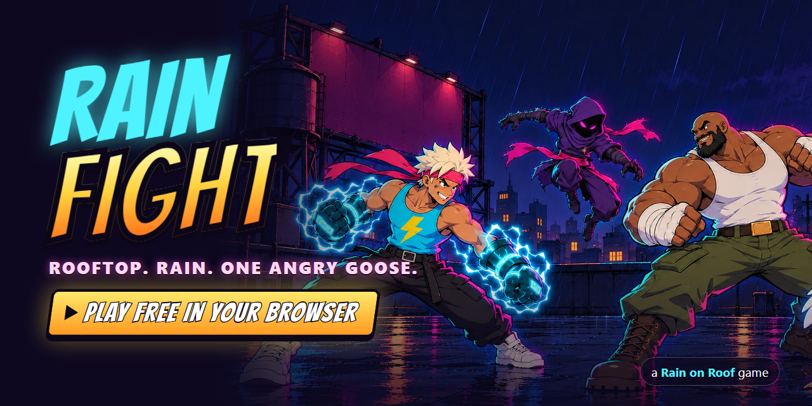</a>

**A cartoon fighting game on a rooftop in the rain. Free, in your browser, on phone or desktop.** 
Four fighters, one of them a goose. Best of three. Then you **END IT**.

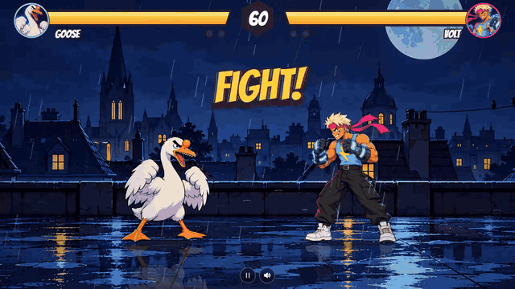

## Fighters

| | | |
|---|---|---|
| 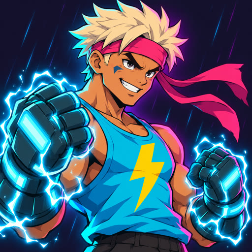 | **VOLT** | Fast hands, faster bolts. Throws lightning across the roof. Finisher: **TOASTED**. |
| 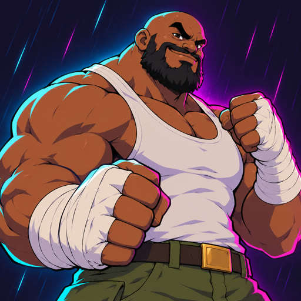 | **BRICK** | Hits like a falling fridge. Slams the roof and sends a shockwave along the floor. Finisher: **NAILED**. |
| 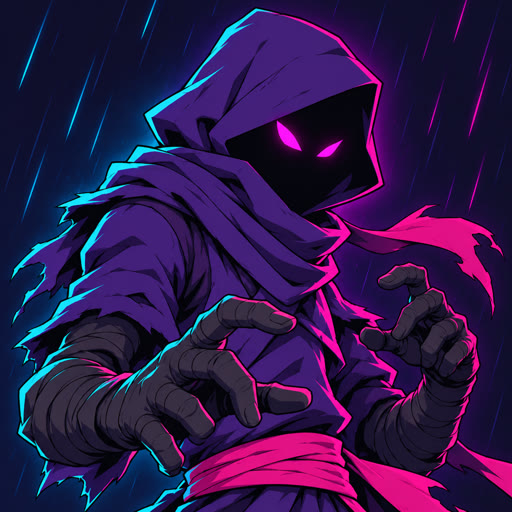 | **SHADE** | Now you see him. Steps through shadow and strikes from behind. Finisher: **UNDRESSED**. |
| 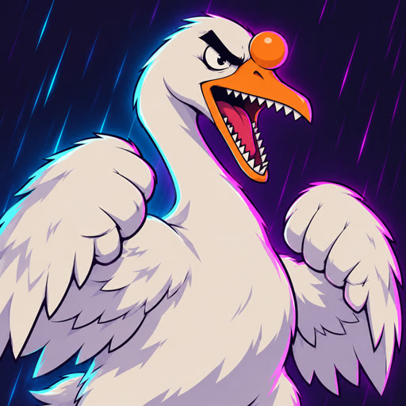 | **GOOSE** | Escaped from a park. Angry. The honk is a weapon. Finisher: **HONKED**. |

## How to play

Win two rounds. When the last round ends, the loser wobbles and the screen shouts **END IT!** Walk up and press **special** before the window closes.

| | Keyboard | Touch | Gamepad |
|---|---|---|---|
| Move, jump, crouch | <kbd>W</kbd><kbd>A</kbd><kbd>S</kbd><kbd>D</kbd> or arrows | stick | d-pad / left stick |
| Punch | <kbd>J</kbd> or <kbd>Z</kbd> | **P** | X / □ |
| Kick | <kbd>K</kbd> or <kbd>X</kbd> | **K** | A / ✕ |
| Special | <kbd>L</kbd> or <kbd>C</kbd> | **S** | Y / △ |
| Block | <kbd>Space</kbd> or <kbd>Shift</kbd> | **B** | B / ○ or shoulders |

Two players on one keyboard: player 1 on <kbd>WASD</kbd> + <kbd>J</kbd><kbd>K</kbd><kbd>L</kbd> + <kbd>Space</kbd>, player 2 on arrows + <kbd>,</kbd><kbd>.</kbd><kbd>/</kbd> (or numpad <kbd>1</kbd><kbd>2</kbd><kbd>3</kbd> + <kbd>0</kbd>). Two gamepads work too.

Crouch under high attacks, block low against sweeps, jump the shockwave. Uppercuts launch, and a launched fighter can be juggled.

  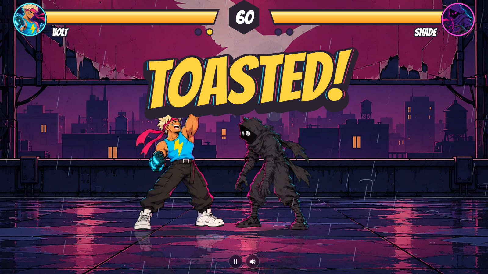
  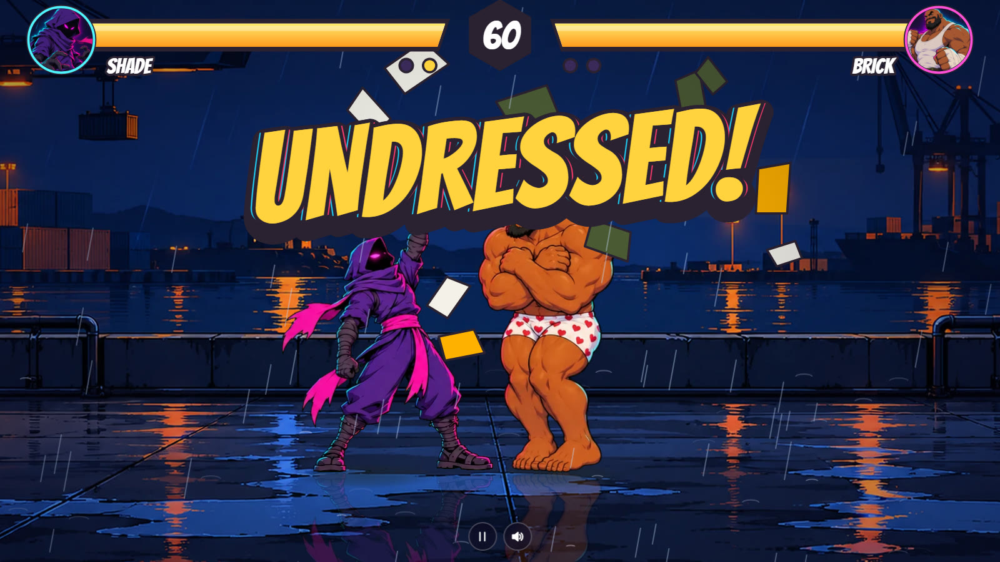
  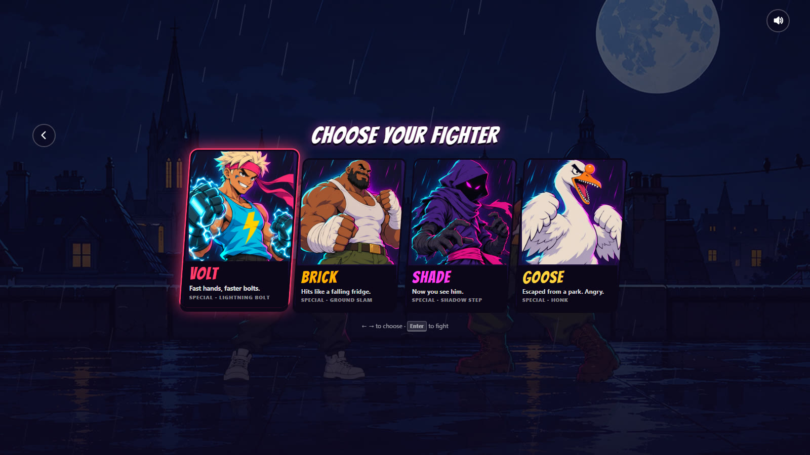
  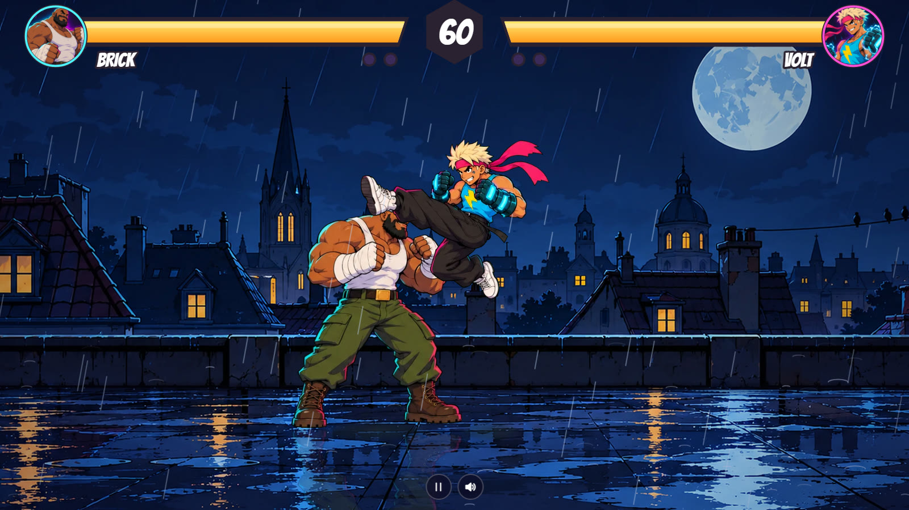

## What's in it

- **Four rooftops**: Chinatown, the old town, the harbor and the billboard roof, a different one every match. Rain, lightning, wet reflections.
- **Real fighting-game rules**: frame data, hitstun and blockstun, high/mid/low, chip damage, juggles with a cap, combo scaling, hitstop, projectiles, a teleport.
- **A CPU with three levels** that reacts with a human delay instead of reading your inputs.
- **Music that hits**: a drift-phonk fight track with 808s and cowbells that gets busier in the final round, a darksynth menu, a fanfare when you win and a sad trombone when you don't. All synthesised live, nothing to download.
- **Plays anywhere**: a control deck under the fight on a phone held upright, overlay controls on its side, keyboard and gamepad on desktop.

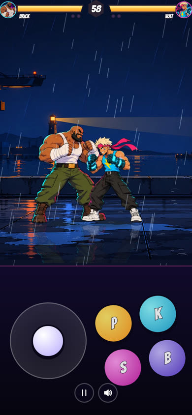

## Under the hood

Plain HTML, ES modules and Canvas 2D: no build step, no dependencies, no server.

| Path | What it does |
|---|---|
| `src/fight/` | The fight itself, pure and deterministic at 60 steps a second: moves and frame data, fighters, rounds and finishers, the CPU. No DOM. |
| `src/render/` | Sprites, the painted stages with parallax, effects, the HUD, finishers, the HONK cut-in. |
| `src/portal.js` | The only contact with a portal: SDK start, language, saves, pause and audio, ads between matches. A no-op on the open web. |
| `src/i18n.js` | Interface copy in English, Russian, Ukrainian, Spanish, Portuguese, German, French and Turkish. |
| `src/audio.js` | The synth: a step sequencer for both tracks, stingers, layered hit sounds, rain and thunder. |
| `tools/cut_sprites.py` | Keys the green-screen sprite sheets, finds each pose as a blob, sets its feet anchor and packs one atlas per fighter. |
| `tools/split_stages.py` | Cuts each stage painting into a slow backdrop and a floor that moves with the fight. |
| `tests/` | `npm test`: blocking, lows, juggles, projectiles, teleports, rounds, END IT, CPU vs CPU for every pairing, replay determinism. |

Character sheets, key art and stages were made with AI image generation from our briefs (in `tools/`) and then cut, keyed and animated by the code above.

Run it locally with `node tools/serve.mjs` and open http://localhost:4517.

**Portal build.** `node tools/build_portal.mjs` packs a zip for game portals (Playgama, Y8 and others through Playgama Bridge): platform language, cloud saves, pause and mute on request, an ad between matches, no outbound links. Details in [docs/portals.md](docs/portals.md).

## More from Rain on Roof

 
**[Last Bite](https://github.com/rain-on-roof/last-bite)**: eat your sandwich, don't get honked. Where the goose came from.

---

MIT © Rain on Roof
